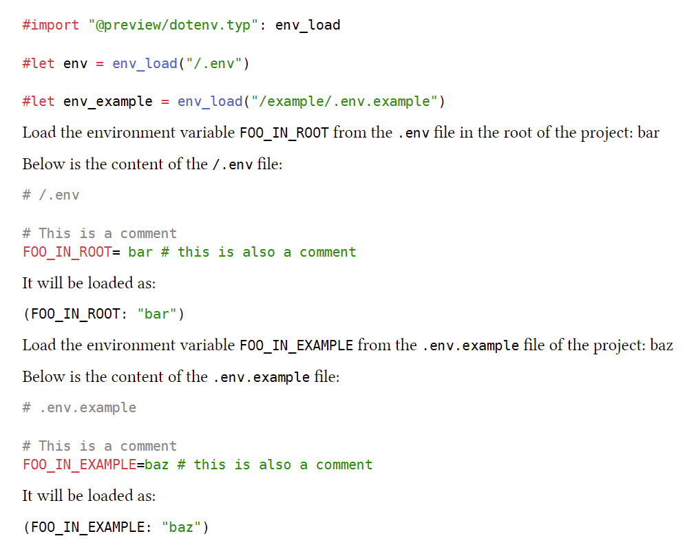

This package has been deprecated in favour of [dovenv](https://typst.app/universe/package/dovenv), which has full support for dotenv file.

---

# tenv

Parse a .env content.

## Usage

```typ
#import "@preview/tenv.typ:0.1.1": parse_dotenv

#let env = parse_dotenv(read(".env"))
```

## Example


